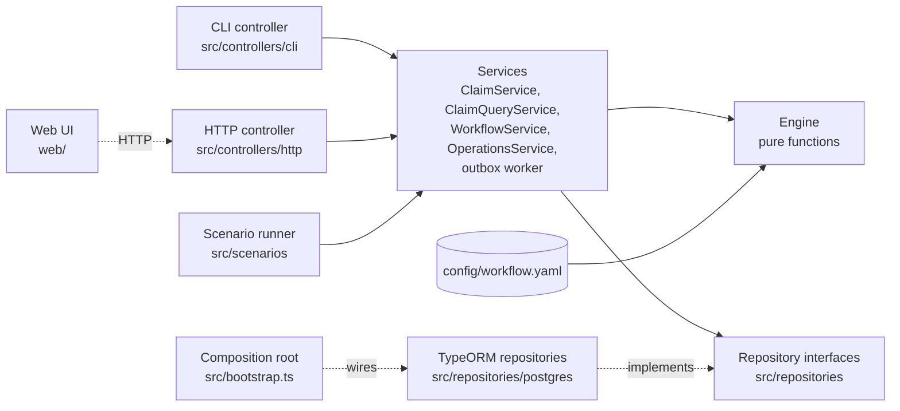
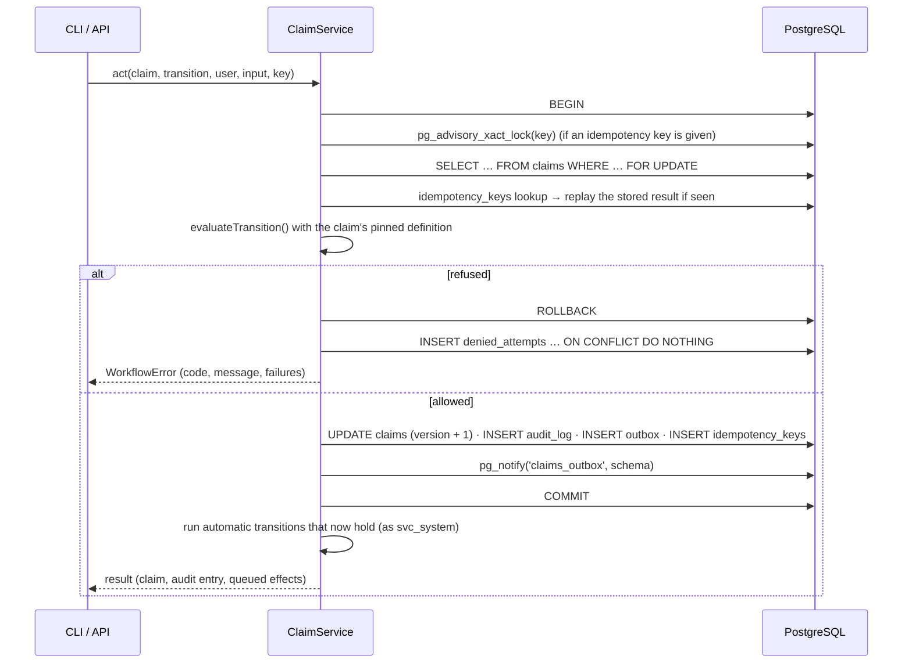

# Design

How the claims workflow orchestrator is built and why. For a quick start see the
[README](../README.md); for adding states and transitions see
[extending-the-workflow.md](extending-the-workflow.md).

## Layers

- **Engine** (`src/engine`): parses and validates the workflow file and evaluates transitions. It
  is pure: no I/O, no clock, no randomness. Time and id generation are passed in. It knows nothing
  about claims beyond a small contract (a claim has a policy, a member, a type, an amount, a state,
  counters and participants).
- **Controllers** (`src/controllers`): the CLI commands, interactive mode and the HTTP routes.
  Each one parses its input, calls one service method and renders or returns the result; the web
  UI talks to the HTTP controller.
- **Services** (`src/services`): all the logic. `ClaimService` runs one transition per database
  transaction; `ClaimQueryService` answers lists, work queues, "what can I do now", the audit
  trail and `verify`; `WorkflowService` stores and pins workflow versions; `OperationsService`
  exposes reference data, the outbox and the mocks; the outbox worker and its handlers deliver
  side effects.
- **Repositories** (`src/repositories`): the interfaces services use for every query, plus a
  `UnitOfWork` for transactions. The PostgreSQL implementations (`src/repositories/postgres`) use
  TypeORM: `EntitySchema` mappings, repositories and query builders, with SQL fragments only where
  TypeORM has no API (sequences, advisory locks, NOTIFY/LISTEN).

Dependencies point one way (controllers → services → repository interfaces), and only
`src/bootstrap.ts` knows the PostgreSQL implementations, so the engine's unit tests run without a
database and `tests/unit/architecture.test.ts` keeps the layers apart.

## The workflow file

Everything specific to health claims is in [`config/workflow.yaml`](../config/workflow.yaml):

| Section | Purpose |
|---|---|
| `workflow` | id, version, initial state |
| `settings` | typed values used by rules: appeal period, four-eyes threshold, filing deadline |
| `roles`, `enums`, `document_requirements` | vocabulary; `system` is service-account-only |
| `fields` | typed schema of the claim's data, against which every path is checked |
| `counters` | named loop limits with their refusal message |
| `rules` | named conditions reused by transitions |
| `templates` | notifications with a recipient and placeholders |
| `states`, `transitions` | the state machine |

**Every action is a transition.** A transition without `from` creates a claim; one with `from`
and `to` changes state; one without `to` is an in-state action such as attaching a document,
assigning an assessor or co-signing. Each declares its `inputs` (typed, with `required`, `min`,
`max_length` …), `roles`, `authorization` (who, on this claim), `increments` (counters),
`preconditions` (whether the claim is ready) and `effects`. Clients call transitions by id; the
CLI's interactive mode and the web UI build their forms from `inputs`.

**Conditions** are a small set of primitives: `compare`, `field_present`, `documents_present`,
`received_since_state_entry`, `duration_elapsed`, `has_role`, `not_performed`, `all_of`, `any_of`,
`not`, and `ref` to a named rule. Each can carry a `code` and a `message` with placeholders, which
become the refusal the user sees.

**Effects** are either internal (`set`, `append`, `clear` on claim fields, applied in the same
transaction) or external (`notify`, `trigger_payment`, `log`, delivered through the outbox).
Values are literals, `$paths`, `$now`, `$uuid` or `{ fn: add, args: [$now, $settings.appeal_period] }`.

### Static checking

The validator (`src/engine/validate.ts`) builds the type of every context a rule can see: the
claim's columns and declared fields, the policy, the actor, `$settings`, counters, participants,
and the inputs of *that* transition. Then it checks the whole file:

- every `$path` and `{placeholder}` resolves, with "did you mean" suggestions;
- compared operands have compatible types (money with money, date with date …), and enum literals
  are values of their enum;
- effects write declared fields with the right type and never touch engine-managed columns;
- referenced roles, states, enums, rules, templates, counters and transitions exist;
- every state is reachable, every non-terminal state has a way out, there is exactly one creation
  transition and automatic transitions belong to service-account roles;
- **every cycle in the state graph passes through a transition that increments a bounded
  counter**, which is what makes "infinite loop" impossible by construction rather than at run time.

A broken file never starts: the CLI, the API and the worker all load through the same validator.

## Evaluating a transition

`evaluateTransition(workflow, claim, request, refs, env)` checks, in this order, and stops at the
first stage that fails:

| # | Check | Error code (HTTP) |
|---|---|---|
| 1 | the transition id exists ("did you mean …") | `UNKNOWN_TRANSITION` (400) |
| 2 | the claim is not in a terminal state | `TERMINAL_STATE` (409) |
| 3 | the claim's state is in `from`; the error lists what *is* available and the shortest path to the target state | `INVALID_TRANSITION` (409) |
| 4 | `expected_version`, when given | `CONCURRENT_MODIFICATION` (409) |
| 5 | the user holds the role and the role may run the transition; service-account roles only for service accounts | `ROLE_NOT_ASSIGNED`, `UNAUTHORIZED_ROLE`, `SERVICE_ACCOUNT_ONLY` (403) |
| 6 | inputs are declared and well-typed | `INVALID_INPUT` (400) |
| 7 | authorization rules on this claim (assigned assessor, claim owner, segregation of duties) | `ACCESS_DENIED` (403) |
| 8 | counters below their max | `CYCLE_LIMIT_EXCEEDED` (422) |
| 9 | preconditions, **all reported together**, including required inputs | `PRECONDITION_FAILED` (422) with one failure per rule |

Preconditions that depend on a value already reported missing are skipped, so one missing
assessment produces "assessment incomplete" instead of three follow-on errors. The engine never
reads the audit history: everything a rule needs (counters, the users who performed each
transition, `state_entered_at`) is kept on the claim.

On success it returns a **plan**: the claim after the transition (state, version, counters,
participants, data), the JSON Patch from the previous snapshot, the SHA-256 of the new snapshot,
a decision context (every value the rules read, every check's outcome, the config hash) and the
rendered outbox messages. `availableTransitions()` runs the same checks as a dry run for the
"what can I do now" checklist.

## One transition, one transaction

- Locks are always taken in the same order (idempotency key, then claim row) and nothing external
  is called inside the transaction, so transactions stay short and cannot deadlock each other.
  `SELECT … FOR UPDATE` plays the role SQLite's `BEGIN IMMEDIATE` would: concurrent actions on one
  claim run one after the other, and the loser re-evaluates against the new state (usually an
  `INVALID_TRANSITION`).
- Replays, automatic transitions and the refusal record run after the transaction has released
  its connection, so a burst of concurrent actions cannot exhaust the connection pool.
- The idempotency record is written in the same transaction as the change, so a retried request
  either sees it or performs the change, never both. A key reused with a different request or by
  another user is refused.
- Timestamps come from the injected clock with millisecond precision (PostgreSQL stores
  microseconds, so the values round-trip exactly and the hashes stay stable); a claim's timestamps
  strictly increase.

## Database guarantees

The schema ([`Init` migration](../src/infra/db/migrations/1792886400000-Init.ts)) enforces what the
application promises, so a bug or a manual query cannot silently break it:

- **Append-only tables.** `audit_log`, `denied_attempts` and `workflow_definitions` reject
  UPDATE and DELETE (row triggers) and TRUNCATE (statement trigger), even for the schema owner.
- **No change without an audit entry.** A deferred constraint trigger fails the commit if a claim
  version has no audit entry with the same version.
- **Claims move one version at a time** and their identity columns (policy, member, type, amount,
  pinned definition) never change; the state must exist in the claim's pinned definition.
- **Least privilege.** The application connects as `claims_app`, which can insert but not update
  or delete audit rows, and cannot delete or truncate anything. Migrations run as `claims_owner`.
- Types and CHECKs everywhere: money as `bigint` below 2^53 (exact in JavaScript), JSONB columns
  must be objects or arrays, hash formats, claim number format, outbox status and lease
  consistency. A generated `assessor_id` column and partial indexes serve the work queues.
- Migrations are TypeORM migration classes, written by hand (tables, keys, checks and indexes
  through TypeORM's schema API with explicit names; functions, triggers and grants in SQL). They
  are append-only: `tests/unit/migrations.test.ts` pins the checksum of every migration file, so
  an edited migration fails CI.

## Tamper evidence

Database rules stop casual edits, but an owner or superuser can disable triggers. The audit trail
is therefore also **verifiable**:

- each entry stores `changes` (JSON Patch), `snapshot_hash` (SHA-256 of the canonical claim
  snapshot after the entry, RFC 8785 JSON), `decision_context` and the config hash;
- entries are chained per claim: `hash = HMAC-SHA256(key, canonical(entry including prev_hash))`,
  starting from `GENESIS`. The key is not in the database, and the application refuses to start
  without one (`AUDIT_HMAC_KEY`, at least 16 characters; the example values are refused when
  `NODE_ENV=production`);
- each external effect an entry lists carries the hash of its outbox payload, so the chain also
  vouches for what the worker will deliver.

`claims verify` (and the API and web button) checks that sequence numbers are contiguous and every
entry links to the previous hash, recomputes each HMAC, replays the patches from an empty document
and compares every snapshot hash, compares the **current claim row with the last entry** (and
prints a diff of the fields changed behind the engine's back), compares every outbox message of
the claim with the payload hash its entry recorded, and re-hashes the stored workflow definitions.
The claim, its entries and its messages are read in one REPEATABLE READ snapshot, so a transition
committing meanwhile is not mistaken for tampering. The outbox worker makes the same check before
it delivers a message: the entry it names must pass its HMAC and list the message's key, type and
payload hash.

| Attack | Result |
|---|---|
| Application bug or SQL as `claims_app` updating/deleting audit rows | prevented (privileges) |
| … changing what an outbox message says (a payment's amount or claim) | prevented (column privileges: only delivery state is writable) |
| … inserting an outbox message no transition queued | not delivered (the worker finds no entry vouching for it); detected: `OUTBOX_TAMPERED` |
| Owner running `UPDATE audit_log` or `TRUNCATE` | prevented (triggers) |
| Owner changing an outbox message's content or reopening a delivered one | prevented (trigger) |
| Owner changing a claim without an audit entry | prevented (deferred trigger) |
| Owner disabling triggers and editing a claim row | detected: `CLAIM_ROW_TAMPERED` with diff |
| … editing audit entries, deleting one in the middle, or rewriting change sets | detected: `ENTRY_TAMPERED`, `SEQUENCE_GAP`, `CHAIN_BROKEN`, `REPLAY_MISMATCH` |
| … editing or deleting outbox messages | detected: `OUTBOX_TAMPERED`, `OUTBOX_MISSING` |
| … editing a stored workflow definition | detected: `DEFINITION_TAMPERED` |
| … deleting a claim's newest entries and resetting the row to the earlier snapshot, or deleting a whole claim | **not detected locally**: the chain has no external anchor (future work, below) |
| Someone with the HMAC key and write access (the owner, or the application, which holds the key) rewriting a claim's whole history consistently | not detected locally: anchor chain heads outside the database and keep the key in a KMS (future work) |

`npm run demo:tamper` shows the claim, audit and definition rows of this table;
`tests/integration/integrity.test.ts` covers the outbox rows.

## Versions and pinning

The config hash is the SHA-256 of the normalised file content (not the YAML text), so comments and
formatting do not change it. At startup the current definition is stored in
`workflow_definitions`; if the same `(workflow_id, version)` is already stored with a different
hash, startup fails with `CONFIG_VERSION_NOT_BUMPED`. Each claim stores the hash it was created
under and is always evaluated with that stored definition, re-hashed on load. New claims use the
new version, existing ones finish under the rules they started with. Moving open claims to a new
version would need an explicit migration step; it is out of scope.

## Side effects: transactional outbox

External effects are rows in `outbox`, inserted in the same transaction as the transition, so a
rolled-back transition never sends anything and a committed one is never lost. Delivery is
**at least once**; handlers are idempotent by key, which makes the effect happen once:

- workers lease due messages with `UPDATE … WHERE id IN (SELECT … FOR UPDATE SKIP LOCKED)`, so
  several workers never take the same message; a lease that expires (crashed worker) is taken
  again;
- failures retry with exponential backoff, capped, with equal jitter (half of each delay random)
  so that messages failing together in an outage do not retry together. Each effect type has its
  own schedule ([`retry-policy.ts`](../src/services/retry-policy.ts)), stored on the message as
  `max_attempts` when it is queued:

  | Effect | Attempts | Delays | Gives up after |
  |---|---|---|---|
  | `trigger_payment` | 20 | 30 s doubling to 1 h | 6 to 13 hours |
  | `notify` | 10 | 5 s doubling to 15 min | 20 to 40 minutes |
  | `log` | 5 | 1 s doubling to 1 min | about 15 seconds |

  The message is then `DEAD`, logged as `[dead]` and listed by `claims outbox list --status DEAD`
  until an operator queues it again: `claims outbox retry <id>`, or after an outage
  `claims outbox retry --all [--claim …] [--type trigger_payment]`;
- the runtime role may only write a message's delivery state (status, attempts, lease, result);
  a trigger keeps its content fixed and a delivered message delivered;
- the worker wakes on `LISTEN/NOTIFY` (sent at commit) and polls every 2 s as a fallback;
- the mock payment gateway stores payments by idempotency key, so a retried or duplicated message
  returns the original payment instead of paying twice; fault injection
  (`claims mock gateway fail-next 2`) demonstrates it;
- notifications are stored in `mock_notifications`; the console shows the subject and a masked
  recipient, never the body.

The CLI never waits for side effects; run `npm run worker` (the API runs a worker in-process). The
scenario runner drains the outbox in-process on a simulated clock, fast-forwarding through
retries.

## Refused attempts

Refusals are evidence too (who tried to approve what, when), but they are not part of the claim's
history and must not let anyone flood the database. They go to `denied_attempts`, outside the hash
chain, at most one row per (claim, user, transition, error code) per minute
(`UNIQUE NULLS NOT DISTINCT … ON CONFLICT DO NOTHING`). The trade-off is that a burst of identical
refusals shows as one row. A refusal never echoes much of the request: at most five unknown input
names are listed, echoed values are cut to 60 characters, and "did you mean" only compares short
names, so a large request cannot produce a large response or row.

## Read access

Reads go through the services with the viewing user (`X-User-Id` on every claim route). The rule
rests on `users.member_id`, the one link every deployment has, not on workflow roles:

- a user linked to a member (a policyholder) sees that member's claims, their audit trail,
  notifications and integrity report, and that member's policies; any other claim answers
  `CLAIM_NOT_FOUND`, as if it did not exist;
- a user without one (staff) sees every claim;
- operator data, meaning refused attempts (they name other users), the outbox and the scheduler
  pass, is for staff only (`ACCESS_DENIED`).

The CLI calls the services without a viewer: it is an operator tool that already holds database
credentials.

Batch reads never stop at a fixed number of claims: the scheduler pass, `verify --all` and work
queues page through every claim (keyset on `created_at, claim_no`). A claim that fails during the
scheduler pass is reported in `failures` and the pass goes on with the next one.

## Choices not made

- **XState**: guards return a boolean, so explaining *why* a transition is blocked would still be
  custom code; the graph is flat, and the engine core is small enough to read in one sitting.
- **An ORM that owns the schema**: TypeORM maps the tables (`EntitySchema`) and builds the
  queries, but it never generates or synchronises the schema. The integrity rules live in SQL
  (triggers, deferred constraints, generated columns, grants), so migrations are written by hand
  and entities declare only columns; `migration:generate` would propose dropping what entities
  cannot express.
- **Event sourcing**: the claim row plus a verifiable patch log gives the same auditability with
  simpler reads; the audit trail can still be replayed (that is what `verify` does).

## Limitations

- Authentication is simulated (`--as`, `X-User-Id`); a deployment would take the user and roles
  from a verified token. For the same reason `GET /api/users` stays open: the web UI lists the
  people one can act as.
- Read access is the fixed policyholder/staff rule above; finer scopes (team, region, assigned
  claims only) would need a read rule in the workflow file, which changes its hash and so needs a
  new workflow version.
- Time-based transitions (closing after the appeal window) run when the scheduler pass is
  triggered (`claims system run`, the API's button, or cron); there is no durable timer service.
- Coverage is a single per-policy limit, as in the challenge; remaining benefit per year or per
  treatment is not modelled.
- Moving open claims to a newer workflow version is not implemented.
