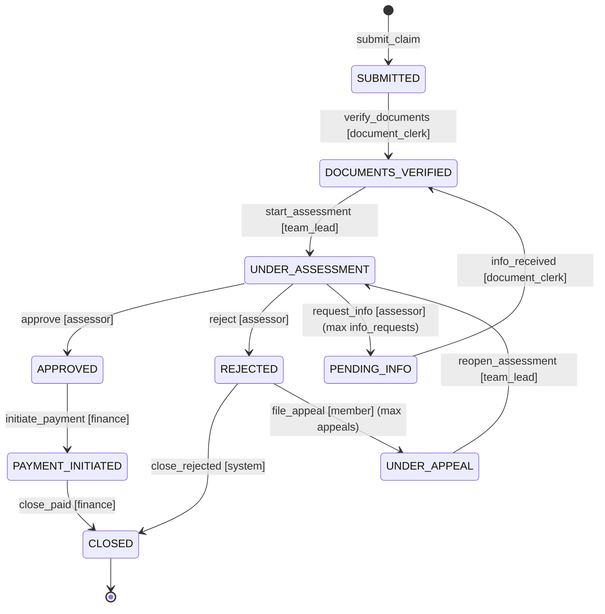

# Extending the workflow without code

The engine knows nothing about claims: states, transitions, roles, inputs, rules, notification
templates and loop limits are all read from the workflow file. This page shows a real extension
made by editing YAML only, and gives ready-to-paste recipes for the gaps found while researching
how health claims are handled in practice.

## What is config and what is code

| Change | Where |
|---|---|
| New state, transition (state change or in-state action), role, input, enum value | workflow YAML |
| New precondition or authorization rule built from the existing primitives: `compare`, `field_present`, `documents_present`, `received_since_state_entry`, `duration_elapsed`, `has_role`, `not_performed`, `all_of` / `any_of` / `not`, `ref` | workflow YAML |
| New notification (template + recipient `member`, `role:<role>` or `user:$path`) | workflow YAML |
| New loop limit (a named counter with `max` and the refusal message) | workflow YAML |
| New claim data (`fields`), required documents per claim type, settings such as thresholds | workflow YAML |
| A new *kind* of condition or effect (say, a fraud score lookup) | a TypeScript primitive in `src/engine`, its type check in `validate.ts`, and a test |
| A new external system (a real payment gateway or e-mail provider) | an outbox handler in `src/infra/outbox` |

Every change to the workflow file needs a new `workflow.version`: the definition is stored by
content hash and a claim stays on the definition it was created with (see
[Safety nets](#safety-nets)).

## Worked example: appeals (workflow v2)

The base workflow ends a rejection with `REJECTED → CLOSED`, even though the rejection notice
already tells the member they may appeal. Version 2 adds the appeal. It lives in
[`config/examples/workflow.appeal.yaml`](../config/examples/workflow.appeal.yaml) and was added
in its own commit, which touches no code:

```console
$ git show --stat f2522b3
f2522b3 feat(config): workflow v2 adds an appeal against a rejection, config only

 config/examples/workflow.appeal.yaml | 632 +++++++++++++++++++++++++++++++++++
 1 file changed, 632 insertions(+)
```

The file is a copy of `config/workflow.yaml` with these changes (output of
`git diff --no-index config/workflow.yaml config/examples/workflow.appeal.yaml`, with some
context lines trimmed):

```diff
@@ -13,7 +15,7 @@
 workflow:
   id: health_claim_reimbursement
-  version: 1
+  version: 2
   label: Health claim reimbursement
   initial_state: SUBMITTED
@@ -116,6 +118,13 @@ fields:
       rejected_at: { type: timestamp }
       appeal_deadline: { type: timestamp }
       acknowledged_at: { type: timestamp }
+  appeal:
+    type: object
+    fields:
+      reason: { type: text }
+      filed_at: { type: timestamp }
+      filed_by: { type: user_ref }
+      reopened_at: { type: timestamp }
   payment_request:
@@ -141,6 +150,9 @@ counters:
   info_requests:
     max: 3
     message: Maximum information requests exceeded — escalate to team lead
+  appeals:
+    max: 1
+    message: This claim has already been appealed once; the decision on the appeal is final
@@ -224,6 +236,14 @@ templates:
     body: "Payment of {claim.payment_request.amount|money} for claim {claim.claim_no} is complete. Payment reference: {claim.payment.confirmation_ref}."
+  appeal_received:
+    to: member
+    subject: Appeal for claim {claim.claim_no} received
+    body: We received your appeal for claim {claim.claim_no}. An assessor who was not involved in the original decision will review it.
+  appeal_review_requested:
+    to: role:team_lead
+    subject: Appeal filed for claim {claim.claim_no}
+    body: "Claim {claim.claim_no} (rejected: {claim.rejection.reason_code}) was appealed on {claim.appeal.filed_at|datetime}. Assign a different assessor and reopen the assessment."
@@ -234,6 +254,8 @@ states:
   REJECTED: { label: Rejected, description: "Claim denied" }
+  UNDER_APPEAL:
+    { label: Under appeal, description: "Member appealed the rejection; awaiting a new assessor" }
   PAYMENT_INITIATED: { label: Payment initiated, description: "Payment processing started" }
@@ -309,7 +331,7 @@ transitions:
   - id: assign_assessor
     label: Assign assessor
-    from: [DOCUMENTS_VERIFIED, UNDER_ASSESSMENT]
+    from: [DOCUMENTS_VERIFIED, UNDER_ASSESSMENT, UNDER_APPEAL]
@@ -561,3 +583,50 @@ transitions:
       - { type: log, message: "Claim {claim.claim_no} archived" }
+
+  # ── Appeal (new in version 2) ─────────────────────────────────────────────
+  - id: file_appeal
+    label: File an appeal
+    from: REJECTED
+    to: UNDER_APPEAL
+    roles: [member]
+    inputs:
+      reason: { type: text, required: true, max_length: 2000, label: Grounds for the appeal }
+    authorization: [{ ref: own_claim }]
+    # The cycle UNDER_ASSESSMENT → REJECTED → UNDER_APPEAL → UNDER_ASSESSMENT must be bounded:
+    # without this counter the config is rejected at load time.
+    increments: [appeals]
+    preconditions:
+      - type: compare
+        left: $now
+        op: lt
+        right: $claim.rejection.appeal_deadline
+        code: APPEAL_WINDOW_CLOSED
+        message: The appeal window closed on {claim.rejection.appeal_deadline|datetime}
+    effects:
+      - type: set
+        path: claim.appeal
+        value: { reason: $input.reason, filed_at: $now, filed_by: $actor.user_id }
+      - { type: notify, template: appeal_received }
+      - { type: notify, template: appeal_review_requested }
+
+  - id: reopen_assessment
+    label: Reopen assessment
+    from: UNDER_APPEAL
+    to: UNDER_ASSESSMENT
+    roles: [team_lead]
+    preconditions:
+      - type: field_present
+        path: $claim.assessor_id
+        code: ASSESSOR_NOT_ASSIGNED
+        message: Assign the assessor who will review the appeal first
+      - type: not_performed
+        user: $claim.assessor_id
+        actions: [reject]
+        code: SOD_VIOLATION
+        message: "Segregation of duties: {user} rejected this claim and cannot review the appeal"
+    effects:
+      - { type: clear, path: claim.assessment }
+      - { type: clear, path: claim.cosign }
+      - { type: set, path: claim.appeal.reopened_at, value: $now }
+      - { type: set, path: claim.timers.assessment_started_at, value: $now }
```

(The two comment lines at the top of the file also changed.)

What this gives, with no code change:

- a new state and two transitions, shown in `claims show`, the web UI's action panel and the
  generated diagram below;
- a new input (`reason` on `file_appeal`), so the CLI's interactive mode and the web form ask for
  it, typed and required;
- two new notifications delivered by the outbox worker;
- a rule reusing an existing primitive: the assessor reviewing the appeal must not be the one who
  rejected the claim (`not_performed` reads the participants recorded on the claim);
- a second loop limit: one appeal per claim, refused with the configured message.



Try it:

```sh
npm run cli -- config validate config/examples/workflow.appeal.yaml
npm run cli -- --config config/examples/workflow.appeal.yaml create --as u_member_01 \
  --policy POL-001 --type outpatient --amount 2500000 -i treatment_date=2026-10-15
npm run api -- --config config/examples/workflow.appeal.yaml     # web UI on the new version
```

[Scenario 12](results/scenarios.md) runs the whole appeal on PostgreSQL. It also shows that a
claim rejected under v1 cannot be appealed after v2 is deployed, because it stays pinned to v1.
`tests/unit/extension.test.ts` covers the same rules on the pure engine.

## Safety nets

The validator runs every time a workflow file is loaded (`claims config validate`, the CLI, the
API, the worker) and refuses to start on any error. For example, without
`increments: [appeals]`:

```console
$ npm run cli -- config validate no-counter.yaml
Invalid workflow config no-counter.yaml
  • transitions: unbounded cycle UNDER_ASSESSMENT → REJECTED → UNDER_APPEAL → UNDER_ASSESSMENT
    (transitions: reject, file_appeal, reopen_assessment): add `increments: [<counter>]` to at
    least one of these transitions
```

It also checks each of the following:

- every `$path` and `{placeholder}` against the declared fields, the transition's own inputs,
  settings and counters, with "did you mean" suggestions;
- that compared values have compatible types and that effects write declared fields with the
  right type;
- that referenced roles, states, enums, rules, templates and counters exist;
- that every state is reachable and has a way out.

Two rules govern versions:

- **Bump the version.** Editing a workflow without changing `workflow.version` is refused at
  startup (`CONFIG_VERSION_NOT_BUMPED`). A version number therefore always means one exact
  definition.
- **Pinning.** Each claim records the hash of the definition it was created under. New claims
  use the current file. Existing claims keep being evaluated with their stored definition (read
  from `workflow_definitions`, re-hashed on load). `claims config list` shows every registered
  version. Moving open claims to a new version would be an explicit migration step; it is not
  implemented here.

## Recipes

Each block below is a partial workflow file: merge its sections into `config/workflow.yaml` and
bump `workflow.version`. A unit test (`tests/unit/recipes.test.ts`) merges every block into the
shipped workflow and validates the result, so these snippets stay correct.

### Missing documents at intake

The base workflow can only refuse `verify_documents` while documents are missing. This lets the
clerk tell the member what to send. It is an in-state action, so it creates no cycle.

<!-- recipe: request-documents -->
```yaml
fields:
  document_requests:
    type: list
    of:
      type: object
      fields:
        text: { type: text }
        requested_by: { type: user_ref }
        requested_at: { type: timestamp }

templates:
  documents_requested:
    to: member
    subject: Documents needed for claim {claim.claim_no}
    body: "To verify claim {claim.claim_no} we still need: {input.documents_needed}. Please upload them in the member portal."

transitions:
  - id: request_documents
    label: Request missing documents
    from: SUBMITTED
    roles: [document_clerk]
    inputs:
      documents_needed: { type: text, required: true, max_length: 1000, label: What is missing }
    preconditions:
      - type: not
        code: DOCUMENTS_COMPLETE
        message: All required documents are already present
        condition: { type: documents_present }
    effects:
      - type: append
        path: claim.document_requests
        value: { text: $input.documents_needed, requested_by: $actor.user_id, requested_at: $now }
      - { type: notify, template: documents_requested }
```

### Payment returned by the bank

The base workflow has no failed-payment state. Retries form a cycle, so a counter is required.
The retry issues a new payment request id, so it gets its own idempotency key at the gateway
instead of being treated as a duplicate of the failed transfer.

<!-- recipe: payment-failed -->
```yaml
states:
  PAYMENT_FAILED: { label: Payment failed, description: "The bank returned the transfer" }

counters:
  payment_retries:
    max: 2
    message: The payment failed again — confirm the member's bank details before retrying

fields:
  payment_failure:
    type: object
    fields:
      reason: { type: text }
      failed_at: { type: timestamp }

templates:
  payment_failed:
    to: member
    subject: Payment for claim {claim.claim_no} did not go through
    body: "We could not complete the payment for claim {claim.claim_no}: {claim.payment_failure.reason}. Please check your bank details in the member portal."

transitions:
  - id: payment_failed
    label: Record a failed payment
    from: PAYMENT_INITIATED
    to: PAYMENT_FAILED
    roles: [finance]
    authorization: [{ ref: not_decision_maker }]
    inputs:
      reason: { type: text, required: true, max_length: 500, label: Reason given by the bank }
    effects:
      - {
          type: set,
          path: claim.payment_failure,
          value: { reason: $input.reason, failed_at: $now },
        }
      - { type: notify, template: payment_failed }

  - id: retry_payment
    label: Retry the payment
    from: PAYMENT_FAILED
    to: PAYMENT_INITIATED
    roles: [finance]
    authorization: [{ ref: not_decision_maker }]
    increments: [payment_retries]
    effects:
      - { type: set, path: claim.payment_request.id, value: $uuid }
      - type: trigger_payment
        amount: $claim.payment_request.amount
        reference: $claim.payment_request.id
```

### Escalation to a team lead

The refusal of a fourth information request says "escalate to team lead", but the base workflow
has nowhere to escalate to.

<!-- recipe: escalation -->
```yaml
states:
  ESCALATED: { label: Escalated, description: "A team lead decides how the assessment continues" }

counters:
  escalations:
    max: 2
    message: This claim has already been escalated twice

templates:
  claim_escalated:
    to: role:team_lead
    subject: Claim {claim.claim_no} escalated
    body: "Assessor {actor.user_id} escalated claim {claim.claim_no} after {claim.counters.info_requests} information request(s): {input.reason}"

transitions:
  - id: escalate
    label: Escalate to a team lead
    from: UNDER_ASSESSMENT
    to: ESCALATED
    roles: [assessor]
    authorization: [{ ref: assigned_assessor }]
    increments: [escalations]
    inputs:
      reason:
        { type: text, required: true, max_length: 2000, label: What the team lead should decide }
    effects:
      - { type: notify, template: claim_escalated }

  - id: resume_assessment
    label: Resume the assessment
    from: ESCALATED
    to: UNDER_ASSESSMENT
    roles: [team_lead]
    inputs:
      reason: { type: text, required: true, max_length: 2000, label: Decision }
```

To let the team lead hand the claim to another assessor while it is escalated, also add
`ESCALATED` to `assign_assessor.from`.

### Withdrawal by the member

A new terminal state reachable from every state before a decision.

<!-- recipe: withdrawal -->
```yaml
states:
  WITHDRAWN: { label: Withdrawn, description: "The member withdrew the claim", terminal: true }

transitions:
  - id: withdraw
    label: Withdraw the claim
    from: [SUBMITTED, DOCUMENTS_VERIFIED, UNDER_ASSESSMENT, PENDING_INFO]
    to: WITHDRAWN
    roles: [member]
    authorization: [{ ref: own_claim }]
    inputs:
      reason: { type: text, max_length: 500, label: Why (optional) }
```
